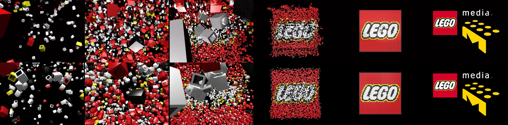

# LEGO Media intro, recreated in three.js

**[▶ Watch it live in your browser](https://webbanditten.github.io/LEGO-Games-Intro-Render/)** · rendered videos: [1080p60](https://github.com/Webbanditten/LEGO-Games-Intro-Render/releases/download/v2.2/lego-intro-1080p.mp4) · [4K60](https://github.com/Webbanditten/LEGO-Games-Intro-Render/releases/download/v2.2/lego-intro-4k.mp4)

[](https://webbanditten.github.io/LEGO-Games-Intro-Render/)

A frame-accurate, real-time recreation of the classic **LEGO Media** intro
(`intro.mp4`): thousands of 1x1 bricks rain out of the dark, swarm past the
camera and lock into a 60x60 brick mosaic of the LEGO logo, which dissolves
into the flat logo before the "LEGO Media" mark slams in.


<sub>Top row: the original `intro.mp4`. Bottom row: this recreation at the same moments.</sub>

As suspected, the original is a **reversed explosion**, and this recreation is
built the same way. Each of the 3600 logo bricks follows a blast path in
"explosion time" `s = 11.0 − t`, played backwards. On top of those are a few
dozen near-camera fly-by bricks. Their timing, size and speed are copied from
the original, and they leave the frame for good.

## Run it

```sh
npm install      # only needed for the dev tools (three.js is vendored in vendor/)
npm start        # → http://localhost:8080/   (HOST=0.0.0.0 npm start to reach it from the LAN)
```

Any static file server works, `python3 -m http.server` included. The page
loads its SVGs and the soundtrack with `fetch`, so serve it over HTTP: opened
as `file://` it only shows a message explaining that.

Click **Play**: browsers only start audio after a click. The Play button reads
"Loading…" until everything is ready.

| Key / control | |
|---|---|
| Space, or a click on the picture | play / pause |
| R | restart |
| M / "Sound" button | original soundtrack → synthesised soundtrack → off |

URL options:

- `?audio=synth`: play the WebAudio re-synthesis of the soundtrack instead of the original track.
- `?audio=off`: play silently.
- `?t=10.5`: start at a given time.
- `?debug`: show a time scrubber and the frame counter.
- `?brick=stl`: build every brick from the supplied `LEGO 1X1 BRICK (correct dimentions).stl` model instead of the procedural brick.
- `?capture`: no UI, deterministic rendering through `window.__renderAt(t)`. The tools use this.

## How faithful is it?

Everything was measured from `intro.mp4` first, then matched:

- **Timing:**
  - The first brick appears at 0.33 s.
  - The swarm thickens until about 5 s, and the camera dollies back from about 6.5 s, eased in from rest so the convergence never starts with a jolt.
  - The mosaic is complete at 11.0 s, with a few bricks at the blast centre settling until 11.27 s.
  - The stud mosaic dissolves into the flat logo over 11.2 to 12.1 s.
  - The logo moves left over 13.03 to 13.47 s, linearly.
  - The Media mark grows from 13.56 s with a 1.8 % overshoot.
- **One deliberate deviation.** The original drops the last few degrees of brick misalignment in a single 15 fps frame. At 60 fps that reads as a jolt, so here the bricks ease into place over the final 0.4 s.
- **The swarm:**
  - Each falling brick is aimed at a vanishing point below the frame, so the swarm fans out like the original: the left side streams down and to the right, the right side down and to the left.
  - The bricks rain through the full height of the frame and out at the bottom. They only turn back toward the logo once the camera pulls back. The fall speed was matched with optical flow, frame third by frame third.
  - From 2 to 5 s, a few hundred bricks that join the logo late make an extra early pass: they fall through the frame at about the logo's distance, then switch to their own path while out of view. Counted by size in the rendered frames, the number of small bricks in view at 3 to 5 s is within a few percent of the original's.
  - The colour shares, red/white/yellow area per frame and entry edges follow the original, and so does how settled the logo looks between 9.3 and 11 s.
  - Known gap: from about 5 to 7 s the original shows more small bricks, roughly 1.5 to 1.7 times as many, and fewer mid-size red ones.
  - The fly-bys and the late bursts of grey, white and red bricks follow the original frame by frame, including which face they show: several turn the LEGO stud toward the camera. The last three white bricks glide into the letters along tracks measured from the video.
  - `node tools/stats.mjs`, `tools/area_stats.py` and `tools/settle_curve.py` print the comparisons.
- **The mosaic:**
  - It is 60 x 60 bricks with a black 1-brick border ring, sampled from `LEGO_logo.svg`.
  - The (R) is left out of the mosaic but kept in the flat logo, as in the original.
  - The sampled grid agrees with the bricks in the video on 97.7 % of cells.
- **The look:**
  - Phong plastic.
  - A late-90s smooth-shaded brick: "pillow" normals, a domed stud, and the slanted LEGO wordmark embossed on every stud. The wordmark is cut from the logo SVG itself.
  - The lights blend from a contrasty top-lit rig during the swarm to a near-frontal rig for the finished mosaic. The mosaic end of that blend was fitted numerically to the original with `tools/calibrate.mjs`: cell, stud and seam colours, the whole-field colour and the top-to-bottom falloff.
- **The bricks.** They have real 1x1 proportions: 7.8 x 7.8 x 9.6 mm with a Ø4.8 mm stud and a hollow underside.
- **The end card:**
  - The flat logo and the yellow brick / "media." mark are placed with sub-pixel coordinates measured from the last frame.
  - The wordmark is an outline, so it looks the same on every system.
  - The logo's yellow outline is thinned to the video's width.
- **Sound:**
  - The original track is a stream copy of the audio of `intro.mp4`: `assets/intro-audio.m4a`, 250 kB.
  - A full re-synthesis is also included, calibrated band by band against the original. It has an F1 sawtooth drone, glassy "brick" pings, two rising chirp sweeps and the impact at 13.78 s.
  - The picture follows the audio clock. If the audio output stalls, playback continues silently.

The original was rendered at 25 fps and published at 15 fps. The recreation
animates continuously, so it runs smoothly at any refresh rate and resolution.

## Project layout

| Path | What |
|---|---|
| `index.html` | the page: a 4:3 stage, letterboxed, plus early error messages |
| `src/choreography.js` | all motion as pure math: camera dolly and roll, per-brick reversed-explosion paths, scripted fly-bys, landing glides, late scatter, final settle |
| `src/lighting.js` | the light rig and its swarm-to-mosaic blend |
| `src/bricks.js` | brick geometry (procedural or STL), materials, the instanced mesh |
| `src/logo.js` | SVG to mosaic grid, flat-logo texture, stud-text normal map |
| `src/overlay.js` | the 2D layer: mosaic-to-logo dissolve, logo move, Media-mark zoom with motion blur |
| `src/audio.js`, `src/soundtrack.js` | soundtrack playback, clock and synthesis |
| `src/curves.js` | monotone keyframe curves and the seeded RNG |
| `assets/` | end-card SVG, soundtrack, reference 60x60 mosaic |
| `vendor/three/` | three.js r186 (MIT) |
| `tools/` | headless renderer, comparisons, statistics, calibration, dev server |

## Tools

```sh
tools/extract-original.sh                            # original frames → renders/original/ (used by the comparisons)
node tools/render.mjs --out renders/run --compare    # 237 frames + render.mp4 (with soundtrack) + compare.mp4 (original | ours)
node tools/render.mjs --fps 60 --width 2880 --height 2160 --out renders/4k   # 4K60
node tools/stats.mjs                                 # brick counts, sizes, colours, entry edges, near-camera guard
python3 -I tools/area_stats.py renders/run renders/original 61 91 121        # colour area per frame
python3 -I tools/settle_curve.py renders/run renders/original               # how settled the logo is, 9.3-11 s
node tools/calibrate.mjs                             # re-fit the mosaic lighting against the original
node tools/check-grid.mjs                            # browser-sampled mosaic vs. assets/mosaic-60.txt
```

`render.mjs` drives the system Google Chrome through `puppeteer-core`. Set
`CHROME=/path/to/chrome` if it lives elsewhere. It needs `ffmpeg` for the
videos, and `--audio none` skips the soundtrack.

The first approved build is tagged `v1-first-render`.
